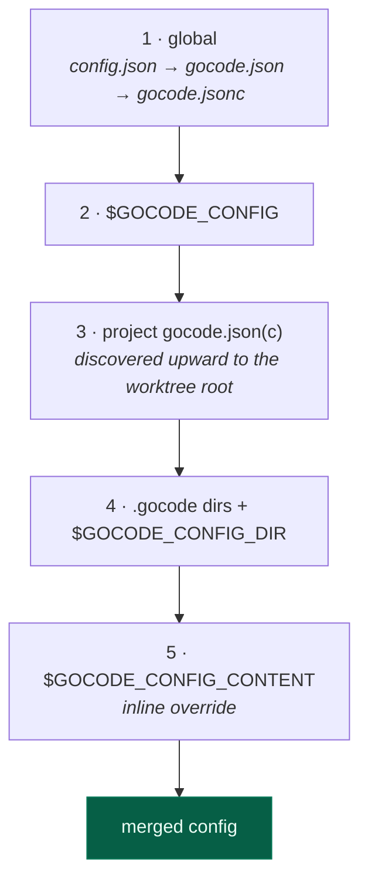

# 7. Configuration

[← The TUI](06-tui.md) · [Index](README.md) · [Next: HTTP API →](08-http-api.md)

---

Config is JSONC — JSON with comments and trailing commas — deep-merged from
several sources.

## Precedence

Later sources win, merged key by key (`internal/config/loader.go`):



Global lives under `$XDG_CONFIG_HOME/gocode/` (`~/.config/gocode/` by
default).

Two behaviours worth knowing:

- **Project config is discovered upward** to the worktree root, so running in
  `repo/src/deep/dir` still picks up `repo/gocode.json`.
- **Errors in global config are tolerated**; errors in project config are not.
  A broken file in your home directory shouldn't make every project unusable,
  but a broken file in *this* project should be reported rather than silently
  half-applied.

`GOCODE_DISABLE_PROJECT_CONFIG=1` skips project sources entirely.

The merge is a **deep merge**: setting one key under `permission` in project
config doesn't discard the global `permission` block.

## Variable substitution

Two token forms, applied before parsing:

```jsonc
{
  "provider": {
    "mine": {
      "options": {
        "apiKey": "{env:MY_API_KEY}",        // from the environment
        "baseURL": "{file:./endpoint.txt}"   // from a file
      }
    }
  }
}
```

| Token | Resolves | Missing |
|---|---|---|
| `{env:VAR}` | process environment | empty string |
| `{file:path}` | file contents, relative to the config file's directory, `~/` expanded | **error** |

The asymmetry is deliberate: an unset environment variable is a normal
condition, but a config pointing at a file that isn't there is a mistake.

Keeping secrets in `{env:...}` is what lets `gocode.json` be committed.

## Reference

```jsonc
{
  "$schema": "https://opencode.ai/config.json",

  // ── models ──────────────────────────────────────────────
  "model": "anthropic/claude-sonnet-5",
  "small_model": "anthropic/claude-haiku-4-5",  // titles, summaries
  "default_agent": "build",

  // ── interface ───────────────────────────────────────────
  "theme": "gocode-dark",
  "username": "you",
  "shell": "/bin/zsh",
  "keybinds": { "leader": "ctrl+x" },

  // ── behaviour ───────────────────────────────────────────
  "autoupdate": "notify",     // true | false | "notify"
  "share": "manual",
  "autoshare": false,
  "subagent_depth": 1,
  "instructions": ["./docs/conventions.md"],

  // ── providers ───────────────────────────────────────────
  "disabled_providers": ["openai"],
  "enabled_providers": ["anthropic"],
  "provider": { /* see below */ },

  // ── capability ──────────────────────────────────────────
  "permission": { "bash": "ask", "external_directory": "ask" },
  "tools": { "websearch": false },
  "lsp": { /* see below */ },
  "mcp": { /* see below */ },
  "plugin": [ /* see below */ ],
  "agent": { /* see below */ },
  "command": { /* see below */ },

  // ── Harness² ────────────────────────────────────────────
  "harness": { "library": "auto", "crossDomain": false, "model": "", "enabled": true,
               "rolloutTimeout": "2h", "sessionTimeout": "1h", "idleTimeout": "15m" },

  "experimental": {}
}
```

### `model` and `small_model`

Format is `provider/model`. `small_model` is used for cheap background work —
session titles, summaries — so those don't burn frontier-model tokens.

### `instructions`

Extra files appended to the system prompt, after the agent's own prompt
(`internal/session/instruction.go`, porting opencode's `instruction.ts`). Every
turn carries, in order:

1. the first global file that exists: `$XDG_CONFIG_HOME/gocode/AGENTS.md`, else
   `~/.claude/CLAUDE.md`;
2. the project file found walking up from the session directory to the git
   root — `AGENTS.md`, else `CLAUDE.md`, else the deprecated `CONTEXT.md`
   (every ancestor match of the first name found, never two names stacked);
3. each `instructions` entry: a path or glob relative to the project (searched
   upward to the git root), a `~/` path, or an absolute path. URL entries are
   skipped — gocode does not fetch over the network to build a prompt.

Files are re-read every turn, so an edit lands on the next one. Opt out with
`GOCODE_DISABLE_INSTRUCTIONS=1`; `GOCODE_DISABLE_CLAUDE_CODE_PROMPT=1` drops only
the `CLAUDE.md` files.

### `harness`

Harness² (`gocode harness`, `/harness` in the TUI; see
[HARNESS2_PLAN.md](HARNESS2_PLAN.md)):

| Key | Default | Meaning |
|---|---|---|
| `enabled` | `true` | `false` never overlays the harness installed at `.gocode/harness` (also `GOCODE_DISABLE_HARNESS=1`) |
| `library` | `"auto"` | experience-library backend: `auto` uses the gocoder.org Library when library-plugin is loaded and signed in — fully when the service reports the `harness` feature (`GET /library/version`), else skills in the Library and experience on disk (`split`) — and local otherwise; `local`; `cloud` (fail rather than fall back) |
| `crossDomain` | `false` | also show lessons from other domains (cloud backend) |
| `model` | executor's | `provider/model` for the editor, selector and reflector sessions |
| `rolloutTimeout` | `"2h"` | longest one rollout may run; past it the session is interrupted and the rollout recorded as failed (`--rollout-timeout`) |
| `sessionTimeout` | `"1h"` | the same for one editor, selector or reflector session (`--session-timeout`) |
| `idleTimeout` | `"15m"` | stop any rollout or improver session that goes this long without activity — the limit that catches a hung session; keep it above bash's 10-minute command limit (`--idle-timeout`) |

An installed harness (`.gocode/harness/`) is overlaid on every session in the
project, below everything you wrote yourself: its always-on files follow your
instruction files in the system prompt, its `skills/` and `agent/` rank after
your own, and its `hooks.json` rules guard tool calls.

The chat history shows when it applies: the first turn that runs under a
harness gets a **Harness loaded** rule naming where it lives, what it brings
(always-on files, skills, agents, scripts, hook rules) and a fingerprint of its
files. Editing or reinstalling it shows **Harness changed** on the next turn,
removing it **Harness removed**. The marker is a `harness` message in the
session (`session.next.harness.loaded`); it is never sent to the model.

### `permission`

See [Tools & permissions](05-tools-and-permissions.md). Two forms:

```jsonc
"permission": {
  "bash": "ask",                                  // whole tool
  "read": { "*.env": "ask", "*.env.example": "allow" }   // per resource
}
```

### `provider`

```jsonc
"provider": {
  "my-gateway": {
    "npm": "@ai-sdk/openai-compatible",
    "name": "Internal Gateway",
    "options": {
      "baseURL": "https://gateway.internal/v1",
      "apiKey": "{env:GATEWAY_KEY}",
      "timeout": 60000
    },
    "models": {
      "my-model": { "name": "My Model", "limit": { "context": 128000 } }
    }
  }
}
```

`whitelist` / `blacklist` filter which catalog models a provider exposes.
Unknown keys under `options` are **preserved** and passed through — see
`ProviderOptions.UnmarshalJSON`, which keeps them in `Extra` specifically so
provider-specific settings survive a round trip.

### `lsp`

```jsonc
"lsp": {
  "gopls": { "disabled": false },
  "my-server": {
    "command": ["my-lsp", "--stdio"],
    "extensions": [".mylang"]
  }
}
```

> **A parsing trap, fixed and worth remembering.** `"lsp": null` once disabled
> LSP entirely. `json.Unmarshal("null", &someBool)` *succeeds* and leaves the
> bool at `false`, and the code computed `off = !false`. A null that means
> "absent" and a false that means "enabled" are not the same thing.

### `mcp`

```jsonc
"mcp": {
  "github":  { "type": "local",  "command": ["gh-mcp"], "env": { "TOKEN": "{env:GH}" } },
  "remote":  { "type": "remote", "url": "https://mcp.example.com/sse" }
}
```

Each server also takes a `timeout` in milliseconds, applied to both connecting
and each tool call. Defaults: **60s** to connect (the OAuth discovery,
registration and token exchange run inside that budget), **5 minutes** per
tool call — a remote server's slow tools (monorepo code search, batch
queries) should finish rather than fail mid-run.

A server can be switched off without removing it: `"enabled": false` keeps
the entry but skips connecting it. The TUI's `/mcp` dialog and
`gocode mcp enable|disable <name>` write this key (removing it entirely on
enable), into whichever config file — global or project — effectively
defines that server.

Interactive authentication (`gocode mcp auth <name>`) waits **5 minutes** for
the browser consent round-trip — independent of the per-server `timeout` —
then reports `authorization timed out` rather than a bare
`context deadline exceeded`.

```jsonc
"mcp": {
  "stripe": { "type": "remote", "url": "https://mcp.stripe.com", "timeout": 120000 }
}
```

### `plugin`

An ordered array. Each entry is either a bare reference or a
`[reference, options]` pair whose options are handed to the plugin at startup:

```jsonc
"plugin": [
  "my-plugin",                                 // installed by that name
  "./tools/lint",                              // a path, relative to the project
  ["review", { "strict": true, "max": 20 }]    // with options
]
```

A reference resolves in three places, in order: the built-in registry, the
filesystem (relative to the session directory), then
`~/.config/gocode/plugin/<name>`. **There is no npm step** — a name that is
nowhere fails with "not installed" rather than being fetched.

Order is meaningful. Hooks run in load order and each one sees the previous
one's edits, so a plugin listed later can override an earlier one. Built-in
plugins always load first.

Listing a plugin is what *enables* it: copying one into the plugin directory
does nothing on its own. `make install-plugin` does both halves. See
[Plugins](09-integrations.md#plugins).

### `agent`

Agents are named configurations — model, prompt, permissions, tool set:

```jsonc
"agent": {
  "reviewer": {
    "description": "Reviews code without changing it",
    "model": "anthropic/claude-sonnet-5",
    "prompt": "You review code. Never edit files.",
    "tools": { "write": false, "edit": false, "bash": false },
    "permission": { "*": "deny", "read": "allow" }
  }
}
```

Equivalently as markdown in `.gocode/agent/reviewer.md`, with the same fields
as YAML frontmatter and the body as the prompt. Both forms accept exactly the
same shapes.

An agent with **no** permission block gets `MissingAgentPermissions` — deny
everything — rather than inheriting a permissive default.

### `command`

Custom slash commands:

```jsonc
"command": {
  "commit": {
    "template": "Commit the staged changes. Message hint: $ARGUMENTS",
    "description": "write a commit"
  }
}
```

Or as markdown under `.gocode/command/`, where nesting namespaces them:
`command/git/commit.md` becomes `/git/commit`.

Template substitution (`internal/command/expand.go`):

| Token | Expands to |
|---|---|
| `$1`, `$2`, … | positional arguments |
| `$ARGUMENTS` | the whole raw argument string |
| `` !`cmd` `` | the command's output |

The **highest-numbered** placeholder is greedy — it takes its argument and
every one after it, so `/commit $1` with three words gets all three rather
than only the first. If a template uses no placeholders at all and you pass
arguments anyway, they are appended after a blank line, so typing them is never
silently ignored.

`` !`cmd` `` substitutions are bounded at 30 s and substitute *empty* on
failure, so a template referencing a tool you don't have still produces a
usable prompt.

## Where files live

Paths follow the XDG spec (`internal/global/global.go`):

| Path | Holds |
|---|---|
| `$XDG_CONFIG_HOME/gocode/` | `gocode.json`, `auth.json` |
| `$XDG_DATA_HOME/gocode/` | `gocode.db`, `log/`, `repos/` |
| `$XDG_CACHE_HOME/gocode/` | models.dev cache, `bin/` |
| `$XDG_STATE_HOME/gocode/` | per-directory state (last model, …) |
| `./.gocode/` | project agents, commands, skills |
| `./.gocode/harness/` | the installed Harness² harness |
| `$XDG_DATA_HOME/gocode/harness/` | Harness² run directories (`runs/`) and the local experience library (`library/`) |
| `./AGENTS.md` | project instructions |

On macOS and Linux these default to `~/.config`, `~/.local/share`,
`~/.cache`, `~/.local/state`.

---

[← The TUI](06-tui.md) · [Index](README.md) · [Next: HTTP API →](08-http-api.md)
