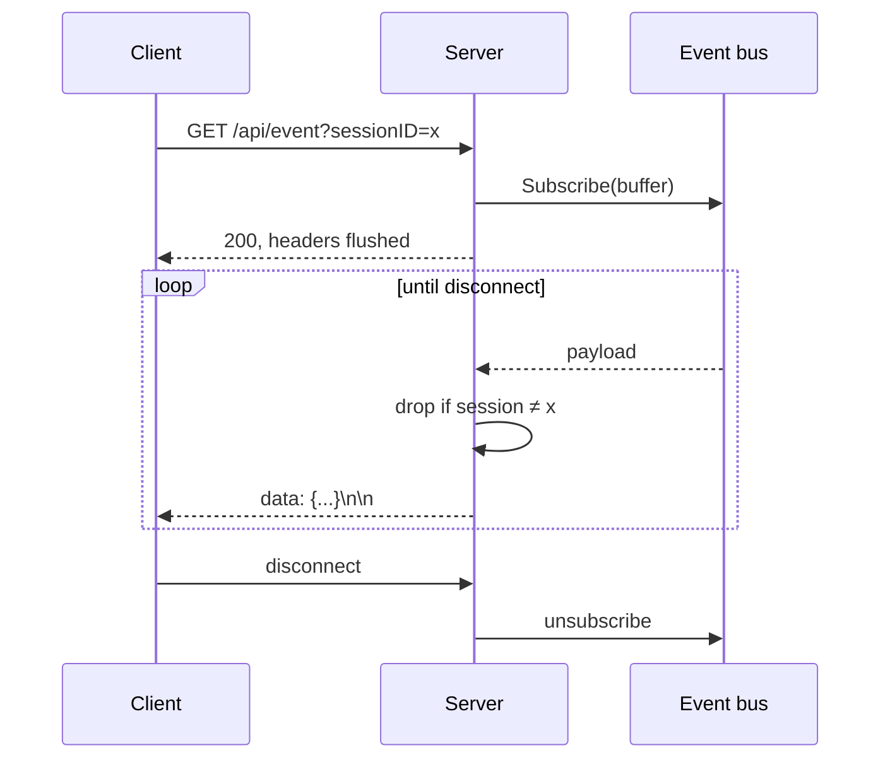

# 8. HTTP API

[← Configuration](07-configuration.md) · [Index](README.md) · [Next: LSP & MCP →](09-integrations.md)

---

The API is the only entry to the core. The TUI uses nothing else, so anything
the TUI can do, a script can do.

```sh
gocode serve --port 4096
```

Binds `127.0.0.1` by default. `--hostname 0.0.0.0` exposes it —
**there is no authentication**, so only do that on a trusted network or behind
a proxy that adds it.

## Shape

- JSON in, JSON out
- Errors are `{"error": "message"}` with a matching status
- `GET /api/event` is Server-Sent Events; everything else is request/response
- Path parameters use Go 1.22+ `ServeMux` patterns (`/api/session/{sessionID}`)

## Sessions

| Method | Path | Does |
|---|---|---|
| `GET` | `/api/session` | list sessions |
| `POST` | `/api/session` | create one |
| `GET` | `/api/session/{id}` | fetch one |
| `DELETE` | `/api/session/{id}` | delete it |
| `GET` | `/api/session/{id}/children` | sub-agent sessions |
| `POST` | `/api/session/{id}/fork` | branch from this point |
| `POST` | `/api/session/{id}/rename` | retitle |
| `GET` | `/api/session/{id}/message` | full history |
| `POST` | `/api/session/{id}/prompt` | **send input** |
| `POST` | `/api/session/{id}/interrupt` | stop the current turn |
| `POST` | `/api/session/{id}/compact` | compact now |
| `POST` | `/api/session/{id}/model` | switch model |
| `POST` | `/api/session/{id}/agent` | switch agent |
| `POST` | `/api/session/{id}/background` | promote running foreground subagents to detached jobs |
| `GET` | `/api/session/{id}/stats` | tokens and cost |
| `GET` | `/api/session/{id}/todo` | todo list |
| `GET` | `/api/session/{id}/status` | busy flag — is a turn running |
| `GET` | `/api/session/{id}/queue` | prompts admitted but not yet reached |

### Session shape

`GET /api/session` and `GET /api/session/{id}` both carry `parentID` and
`agent` on every session (they were previously dropped on read, which left
every client unable to tell a subagent from a root):

```json
{
  "id": "ses_child_1",
  "parentID": "ses_root",
  "agent": "general-purpose",
  "title": "find the bug (@general-purpose subagent)"
}
```

A subagent's task tool call also links back: the call's tool part carries
`state.metadata.sessionID` (plus `parentSessionID`, `title`, and `background`
when detached), published by the `session.next.tool.metadata` event the
moment the child exists — mid-run, before the call settles. Clients use it to
open the child session and to show live progress; `state.status` reads
`"running"` from the call's first projection onward.

### Sending a prompt

```http
POST /api/session/ses_abc123/prompt
Content-Type: application/json

{
  "text": "add a health check endpoint",
  "delivery": "queue",
  "files": []
}
```

```json
{ "messageID": "msg_def456" }
```

Returns as soon as the input is **durably admitted** — not when the work is
done. Watch `/api/event` for progress. This is the inbox from
[Data model](02-data-model.md) surfacing directly in the API.

`delivery` is `queue` (wait for the current request to finish) or `steer`
(join the current request at the next step boundary).

A message with only `files` and no `text` is valid — the handler requires text
only when there is nothing else to send:

```go
// A message carrying only an attachment is legitimate; text is required
// only when there is nothing else to send.
```

## Events

```http
GET /api/event
GET /api/event?sessionID=ses_abc123
```

```
data: {"type":"session.next.text.delta","session":"ses_abc","data":{...}}

data: {"type":"session.next.tool.called","session":"ses_abc","data":{...}}
```

Standard SSE — `text/event-stream`, `no-cache`, flushed per event, held open
until the client disconnects. `sessionID` filters server-side, which matters
when many sessions are active.

Event types are exactly the durable events from
[Data model](02-data-model.md).



Subscriptions are buffered. A client too slow to keep up **loses events** — it
cannot slow the runner down. Clients that must not miss anything should
reconcile with `GET /api/session/{id}/message` on reconnect.

## Permissions & questions

| Method | Path | Does |
|---|---|---|
| `GET` | `/api/permission/request` | pending requests |
| `POST` | `/api/permission/{id}/reply` | answer one |
| `GET` | `/api/session/{id}/permission` | pending for a session |
| `POST` | `/api/session/{id}/permission/{requestID}/reply` | answer, session-scoped |
| `GET` | `/api/question` · `/api/session/{id}/question` | pending questions |
| `POST` | `/api/question/{id}/reply` · `/api/question/{id}/reject` | answer or decline |

This is the round trip that makes permission dialogs work from any client —
see [Tools & permissions](05-tools-and-permissions.md).

## Providers & models

| Method | Path | Does |
|---|---|---|
| `GET` | `/api/provider` | configured providers |
| `GET` | `/api/model` | available models |
| `GET` | `/api/provider/{id}/auth` | auth status |
| `POST` | `/api/provider/{id}/auth` | store a credential |
| `DELETE` | `/api/provider/{id}/auth` | log out |
| `POST` | `/api/provider/auth/oauth` | begin an OAuth flow |
| `GET` | `/api/provider/auth/oauth/{attemptID}` | poll it |

OAuth is two-step because device flow is inherently asynchronous: start an
attempt, get a URL and code to show the user, then poll until they finish.

## Account

The gocoder.org account this machine is signed in to (`gocoder.json`, the
same sign-in `gocode login` writes). The server calls gocoder.org with the
stored API key, so a client never holds a gocoder.org credential itself.

| Method | Path | Does |
|---|---|---|
| `GET` | `/api/account` | who is signed in (`signedIn: false` when nobody is) |
| `PATCH` | `/api/account` | rename: `{"displayName": "…"}` |
| `POST` | `/api/account/login` | sign in: `{"email", "password"}`; replaces and revokes a previous sign-in |
| `POST` | `/api/account/logout` | sign out: revokes the key, removes the sign-in and the settings-sync key |
| `GET` | `/api/account/usage?days=30` | usage summary over 1-90 days |
| `GET` | `/api/account/invite` | invite code, sign-up link and how many have joined through it |

`GET /api/account` sets `expired` when the site rejects the stored key (sign
in again) and `offline` when the site can't be reached (the fields then come
from the stored sign-in). A deployment that answers `/api/auth/me` for
session tokens only still reads as signed in: the key is checked against a
route that takes keys, and the stored name and email are shown.

Whenever `gocoder.json` changes — a sign-in or sign-out through these routes,
from the TUI, or with `gocode login` — the server publishes `account.updated`
(no data) on `/api/event`. Clients refetch `GET /api/account` on it, and on
reconnect, since the stream may have dropped it. Failed calls pass the site's status and message
through, and answer 502 when it can't be reached. Password changes aren't
offered: gocoder.org requires a signed-in browser session for them.

## Everything else

| Method | Path | Does |
|---|---|---|
| `GET` | `/api/health` | liveness — the only route with no session service |
| `GET` | `/api/agent` | configured agents |
| `GET` | `/api/command` | slash commands |
| `GET` | `/api/skill` | skills |
| `POST` | `/api/skill/rescan` | re-run skill discovery on disk in place; returns `{added, removed, count}` |
| `PUT` | `/api/skill/external/{source}` | replace the skills a plugin registers under `source` (`{skills:[{name, description, content, location}]}`); they rank below skills on disk |
| `DELETE` | `/api/skill/external/{source}` | drop them |
| `GET` | `/api/lsp` | language server status |
| `GET` | `/api/mcp` | MCP server status |
| `GET` | `/api/mcp/servers` | every configured MCP server — connected, disabled or failed — with type, endpoint and enable state |
| `POST` | `/api/mcp/{name}/enable` | persist `enabled` (removing the key) to the winning config file and connect |
| `POST` | `/api/mcp/{name}/disable` | persist `enabled: false`, disconnect and unregister the server's tools |
| `DELETE` | `/api/mcp/{name}` | remove the server from its config file and disconnect; stored OAuth credentials are kept |
| `GET` | `/api/job` | background jobs |
| `GET` | `/api/plugin` | loaded plugins, their hooks and tools |

## VCS

The diff viewer's two endpoints (`/diff` in the TUI). Both answer over the
process's working directory — the TS server takes a `directory` per request
because it is multi-project; this one is a single project per process.

| Method | Path | Does |
|---|---|---|
| `GET` | `/api/vcs` | branch + default branch (`{}` outside a repository) |
| `GET` | `/api/vcs/diff?mode=git\|branch&context=N` | per-file patches, counts, status |

```json
[
  {
    "file": "internal/tui/app.go",
    "patch": "--- internal/tui/app.go\n+++ internal/tui/app.go\n@@ …",
    "additions": 12,
    "deletions": 3,
    "status": "modified"
  }
]
```

- `mode` defaults to `git` (working tree against `HEAD`); `branch` diffs
  against the merge base with the default branch and is empty when the
  current branch already is it. An unknown mode is a 400.
- `context` is the context-line window (the TUI passes 12). The server
  default is full context, matching the TS producers.
- A non-git directory is **not** an error: both routes answer empty
  payloads (`{}` / `[]`), which the viewer renders as "working tree only"
  and "No diff!". Patches beyond the total byte cap come back header-only,
  exactly like the TS `emptyPatch` fallback.

### Source Control (`/api/vcs/git/*`)

The desktop client's (`gocode_gui`) git surface, over
`internal/vcs/gitops` — a port of goide's host git service, with no TS
counterpart. Unlike the two routes above, every route takes an optional
`?directory=` (absolute, existing): the client groups sessions by project
folder and each is its own repository. Without it the routes act on the
process's working directory. Operations run at the repository top level;
paths are relative to it.

| Method | Path | Does |
|---|---|---|
| `GET` | `/api/vcs/git/status` | branch, upstream, ahead/behind, in-progress operation, stash count, remotes, `files` (`{isRepo:false}` outside a repository) |
| `GET` | `/api/vcs/git/diff?path=&staged=&untracked=&commit=` | one file's unified diff: `{diff}` |
| `GET` | `/api/vcs/git/branches` | `{current, branches:[{name, upstream, ahead, behind, …}], remote:[…]}` |
| `GET` | `/api/vcs/git/log?limit=&skip=&all=&query=&path=` | `{commits}`, topological order (the client draws the graph) |
| `GET` | `/api/vcs/git/show/{hash}` | message body, changed files, line totals |
| `GET` | `/api/vcs/git/stash` | `{entries}` |
| `POST` | `/api/vcs/git/init` | `git init` in the directory itself |
| `POST` | `/api/vcs/git/stage` | `{paths, all, unstage}` |
| `POST` | `/api/vcs/git/discard` | `{paths, all, includeUntracked}` — restores tracked paths, deletes untracked ones |
| `POST` | `/api/vcs/git/apply` | `{patch, cached, reverse}` — stage / unstage / discard one hunk |
| `POST` | `/api/vcs/git/commit` | `{message, amend, all, signoff}` → `{commit}` (short hash) |
| `POST` | `/api/vcs/git/remote` | `{op: fetch\|pull\|push, rebase, setUpstream, force, tags, …}` → `{output}` |
| `POST` | `/api/vcs/git/checkout` | `{branch, create, startPoint}`; `origin/x` checks out its local tracker |
| `POST` | `/api/vcs/git/branch` | `{op: delete\|rename\|merge, name, newName, force}` |
| `POST` | `/api/vcs/git/commit-op` | `{op: revert\|cherry-pick\|reset-soft\|reset-mixed\|reset-hard\|tag, hash, name}` |
| `POST` | `/api/vcs/git/stash` | `{op: push\|pop\|apply\|drop, index, message, includeUntracked}` → `{entries}` |
| `POST` | `/api/vcs/git/conflict` | `{op: ours\|theirs\|resolved\|abort\|continue, path}` |
| `POST` | `/api/vcs/git/commit-message` | `{stagedOnly, model}` — the model drafts a commit message; streams NDJSON (see below) |

git runs non-interactively (no credential prompts, no editors), so a
request never hangs on input. A git refusal — a conflict, a rejected push,
an empty commit message — answers **422** with git's own message in
`error`; malformed requests are 400.

`commit-message` describes the staged changes (`stagedOnly`) or everything
"Commit All" would take, untracked files included, with one model call —
no tools, no session, nothing in the event log. The model is `model`
(`provider/id`) when given, else `small_model`, else the default model. The
patch sent is capped at 60 KB; the file list always covers every file, and
the eight most recent subjects are included so the message matches the
repository's style. Nothing to describe is a 422 and no provider a 503,
both plain JSON. Once the model is called the reply is
`application/x-ndjson`: `{"text", "model"}` lines with the message so far,
then a final `{"text"|"error", "model", "done": true}`. The final text is
cleaned of preambles, code fences and quotes. Closing the request stops the
model call.

## Memories

Durable memories (the `memory` native plugin's backing store) have their own
management surface — this is what the interface's `/memory` manager talks to:

| Method | Path | Does |
|---|---|---|
| `GET` | `/api/memory` | list memories (management view: includes disabled) |
| `POST` | `/api/memory` | create one |
| `PATCH` | `/api/memory/{id}` | edit, pin, silence |
| `DELETE` | `/api/memory/{id}` | forget it |

## Harness²

Recursive harness adaptation (`internal/harness`, the TUI's `/harness`). A run
id is `<task>--k<k>-<mode>`, the same triple that names its directory, so a
finished run keeps its id across restarts.

| Method | Path | Does |
|---|---|---|
| `GET` | `/api/harness/budgets` | the offered `(mode, k)` pairs with their rollouts/edits counts and one-line descriptions (`harness.Budgets`) |
| `GET` | `/api/harness/run` | live and finished runs, newest first |
| `POST` | `/api/harness/run` | start one: `{prompt, id?, domain?, workspace?, k?, mode?, model?, improverModel?, library?, crossDomain?}`; `dryRun: true` returns the plan (rows, budget, backend) without spending anything. `409` while the same run is going, or while another process holds it (see below) |
| `GET` | `/api/harness/run/{runID}` | one run: status, phase, a row per label (with its rollout `sessionID`, latest editor `editSessionID` and `retries`), cost, adopted label, lesson, and the task's `workspace` + `prompt` (first 200 chars) |
| `POST` | `/api/harness/run/{runID}/cancel` | stop it; finished work stays cached and a rerun resumes |
| `GET` | `/api/harness/run/{runID}/compare?with=installed\|<runID>` | the run's adopted harness against the installed one (default) or another run's adopted one: `{from, to, files, diff}` — what installing it would change |
| `GET` | `/api/harness/installed` | the project's installed harness: `{installed, dir, fingerprint, alwaysOn, skills, agents, scripts, hooks, tree}`; the fingerprint is the chat marker's |
| `GET` | `/api/harness/sweep` | sweeps, running first then newest: live ones from memory, finished ones from their records |
| `POST` | `/api/harness/sweep` | `{paths, domain?, workspace?, k, mode, workers, maxTasks, seed?, model, improverModel, library, dryRun}` — `paths` are task files or folders of `*.md` tasks, relative to the server's working directory; `200` with the plan on `dryRun`, `202` with the running sweep, `409` while another sweep (or one of its tasks) runs. Each task is a live run in `/api/harness/run` while it goes; every change is a `harness.sweep` event carrying `{sweep}` |
| `GET` | `/api/harness/sweep/{sweepID}` | one sweep with its tasks |
| `POST` | `/api/harness/sweep/{sweepID}/cancel` | stop it after the tasks in flight; stopped tasks resume like any run |
| `POST` | `/api/harness/run/{runID}/resume` | start a run that ended short of ok again from its saved `task.json`, same budget and mode, on the server's current models: finished stages and rollouts are reused, only what was cut short runs. `202` with the run; `409` when it is running, locked by another process or already finished ok; `404` when there is no such run |
| `DELETE` | `/api/harness/run/{runID}` | delete a stopped run: its directory and every rollout and editor session under it (the shared base too, when no other mode of that task and k remains); `409` while it runs. The experience library is kept |
| `GET` | `/api/harness/run/{runID}/log` | the run's event log (`events.jsonl` beside its summary), every event time-stamped; `?after=N` returns only events after the first N |
| `GET` | `/api/harness/run/{runID}/stage/{label}` | a label's harness diff against the base, editor notes, and its rollout (session id, deliverable) |
| `POST` | `/api/harness/run/{runID}/install` | `{to: project\|library\|both, force, dryRun, dir?}` — `dir` installs into that directory instead of the server's working directory and must exist; `409` with the result when an installed harness or a Library skill differs and `force` is unset |
| `GET` | `/api/harness/library` | the experience library by domain, with the active backend |
| `GET` / `DELETE` | `/api/harness/library/{domain}/{task}` | one entry (lesson, why, full tree) / forget it |
| `POST` | `/api/harness/library/sync` | upload pending entries and pull other machines' (cloud backend) |

Progress streams on `/api/event` as **live** events — `harness.phase`,
`harness.rollout.started`/`.ended`, `harness.stage.started`/`.ended`,
`harness.selected`, `harness.reflected`, `harness.session` (a stage or
rollout's session exists: `sessionID`, `role`), `harness.stage.retry` (a
rejected proposal and why), `harness.run.ended` — each carrying
`{run, event}` with the run's whole state, so a client that drops one loses
nothing. They are not durable: there is no projector and nothing is stored.

The rollout and editor sessions run on their own stacks; the server relays
their committed events onto its own stream (`event.Bus.Deliver`, subscribers
only), so a client streams those sessions live like any other.

A run directory carries an advisory lock (`<run dir>/.lock`, flock) held for
the run's duration: a CLI run and an API run of one task in two processes
share the directory, so `POST /api/harness/run` and
`DELETE /api/harness/run/{runID}` answer `409` while another process holds
it. The lock is advisory-only (a no-op on Windows, like every flock use in
gocode).

`Mux()` with no session service returns a **health-only** route tree, for
callers that just need a liveness probe.

## A worked example

```sh
BASE=http://127.0.0.1:4096

# create a session
SID=$(curl -sX POST $BASE/api/session | jq -r .id)

# watch it (background)
curl -sN "$BASE/api/event?sessionID=$SID" | \
  while read -r line; do echo "${line#data: }" | jq -c '.type'; done &

# send work
curl -sX POST $BASE/api/session/$SID/prompt \
  -H 'content-type: application/json' \
  -d '{"text":"list the go files","delivery":"queue"}'

# what did it cost
curl -s $BASE/api/session/$SID/stats | jq
```

## Client library

`internal/tui/client` wraps all of this in Go and is what the TUI uses. If you
are building a Go client, start there rather than hand-rolling requests — it
already handles the SSE stream and the event wire format.

---

[← Configuration](07-configuration.md) · [Index](README.md) · [Next: LSP & MCP →](09-integrations.md)
