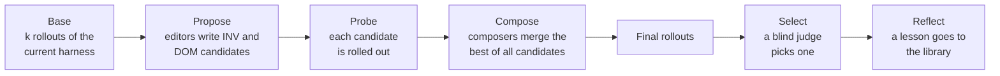

# Harness² — user manual

[← Documentation index](README.md) · [Gocode Desktop → Harness²](11-desktop.md#harness)

---

Harness² makes gocode better at **a kind of task you do repeatedly**, without
touching the model. It runs your task several times, has editor sessions
study what went wrong, tries their improvements, and keeps the version that
produced the best result. What it keeps is ordinary gocode configuration —
prompt text, skills, subagents, scripts and tool rules — that you install into
your project and review like any other file.

It is a port of [google-research/harness2](https://github.com/google-research/harness2)
(Apache-2.0, arXiv:2610.14224); the code is in `internal/harness/`, with the
attribution in `internal/harness/NOTICE`.

## Contents

- [When to use it](#when-to-use-it)
- [Quick start](#quick-start)
- [How a run works](#how-a-run-works)
- [What a harness contains](#what-a-harness-contains)
- [Writing a task](#writing-a-task)
- [Choosing a budget](#choosing-a-budget)
- [Running from the TUI](#running-from-the-tui)
- [Running from the command line](#running-from-the-command-line)
- [Sweeps: many tasks at once](#sweeps-many-tasks-at-once)
- [Reviewing and installing the result](#reviewing-and-installing-the-result)
- [The experience library](#the-experience-library)
- [Stopping, resuming and provider limits](#stopping-resuming-and-provider-limits)
- [Configuration](#configuration)
- [Where things are stored](#where-things-are-stored)
- [Safety](#safety)
- [Troubleshooting](#troubleshooting)
- [Command reference](#command-reference)

## When to use it

Use Harness² when:

- the same **kind** of task keeps coming back (fixing failing tests in one
  repo, writing release notes, adding API endpoints in a house style), and
- gocode does it **acceptably but not well** — it forgets a step, misses a
  project convention, or stops before checking its own work.

It is not the tool for a one-off request: a single run costs several times
what doing the task once costs. It also cannot fix what the model cannot
do at all — it improves the *instructions and tools* around the model, not
the model itself.

> **Cost.** A run at budget `k` performs **4k rollouts** (complete executions
> of your task) and **3k editor sessions**, plus a selector session when
> `k > 1` and a reflector session when the experience library is on. Start
> with `k=1`, and check the estimate with `--dry-run` or the plan screen
> before anything is spent.

## Quick start

**In the TUI.** Open a session in the project, do the task once the normal
way, then:

```
/harness refine
```

The task prompt is pre-filled from the session's first message. Edit it if
needed, press `enter`, pick a budget (start with `parallel k=1`), review the
plan, and confirm. The run continues in the background; its progress is in
the footer, and `/harness` opens it. When it finishes, a toast names the
adopted candidate. Open the run, review the stages, and press `ctrl+s` to
install.

**From the command line:**

```sh
cd ~/src/my-service
gocode harness run --prompt "Fix the failing tests and keep the API stable" --dry-run
gocode harness run --prompt "Fix the failing tests and keep the API stable"
gocode harness install fix-the-failing-tests-and-keep-the-api-stable
```

From then on, every gocode session in that project runs with the installed
harness. The first turn of each session shows a **Harness loaded** marker so
you always know it is there.

## How a run works



1. **Base.** Your task is executed `k` times with the current harness (the
   one installed in the project, or none). Each execution is a *rollout*: a
   full, unattended gocode session in a private copy of your workspace.
2. **Propose.** Editor sessions read the rollouts — the full transcript, the
   final message and the diff each one produced — and propose changes along
   two dimensions:
   - **INV** (*how the agent works*): procedure, tool use, checking its work,
     knowing when it is done.
   - **DOM** (*what a practitioner knows*): conventions of the codebase, the
     shape of a good result, domain rules.
3. **Probe.** Each candidate harness is executed on the same task.
4. **Compose.** Composer sessions read every candidate and its rollout, and
   write a combined harness. In `parallel` mode there are `k` independent
   composers (`agg1…aggk`); in `sequential` mode each round composes one
   checkpoint (`c1…ck`) that the next round builds on.
5. **Select.** The finals are rolled out, anonymised and shuffled, and a
   selector judges **only the results** — did it deliver, does it conform,
   is it faithful to the source, is it consistent, does it work, is it
   finished. With one final there is nothing to choose and no selector runs.
6. **Reflect.** A reflector records which edits helped, hurt or did nothing,
   and writes at most one lesson for the experience library, so later tasks
   in the same domain start ahead.

Nothing here needs a test suite or a reference answer: Harness² improves
from what the rollouts actually did. If your task *does* have an objective
check, say so in the task (for example "the change is done when `make test`
passes") — the rollouts will run it, and the editors and the selector will see
the result.

A run's rows use these labels: `base1…`, `inv1…`, `dom1…`, then `agg1…`
(parallel) or `c1…` (sequential), then `select` and `experience`.

## What a harness contains

A harness is a small directory tree. Only these paths are editable; anything
else a proposal writes is rejected:

| Path | What it is | In the model's context |
|---|---|---|
| `systemprompt.md` | role and procedure | every turn |
| `guardrails.md` | standing rules | every turn |
| `LongTermMEMORY.md` | durable facts about the codebase or domain | every turn |
| `tool_guidance.md` | how to use the tools here | every turn |
| `skills/<name>/SKILL.md` | a reusable workflow, loaded on demand | when used |
| `skills/<name>/scripts/*` | helpers that skill runs | when run |
| `agent/<name>.md` | a subagent with its own prompt (`mode: subagent`) | its own context |
| `scripts/<name>.py` / `.sh` | deterministic helpers | when run |
| `hooks.json` | declarative rules on tool calls | every tool call |

The four always-on files together are capped at **24,000 characters** — every
character there is paid on every turn. Each skill needs `name:` (matching
its directory) and `description:` frontmatter, and must be mentioned from
always-on text so the agent knows to use it. Scripts that a skill calls must
ship with the harness.

`hooks.json` is the one part that is enforced rather than suggested. A
`before` rule refuses a matching tool call; an `after` rule adds a message to
a matching tool result:

```json
{"rules": [
  {"when": "before", "tool": "write", "match": "\\.env\"", "action": "deny",
   "message": "never write .env files; put settings in config.example"},
  {"when": "after", "tool": "bash", "match": "FAILED", "action": "append",
   "message": "a test failed: read the failure before editing again"}
]}
```

`match` is a regular expression over the call's JSON arguments (`before`) or
the tool output (`after`); `tool` is a tool name or `*`.

Check a hand-edited harness with:

```sh
gocode harness validate                  # .gocode/harness
gocode harness validate path/to/harness
```

## Writing a task

The simplest task is a sentence: `--prompt "…"` on the command line, or the
text you type in the TUI. Describe the job the way you would to a colleague,
including what "done" means.

For a task you will run more than once, or a task set for a sweep, write a
**task file**: markdown whose body is the prompt, with optional frontmatter.

```markdown
---
id: add-endpoint
domain: my-service-api
workspace: ../my-service      # relative to this file
work: API change
deliverable: pull-request-ready change
yardstick: make test passes and the OpenAPI spec matches the handlers
---

Add a `GET /v1/orders/{id}/events` endpoint that returns the order's event
history, newest first, paginated like `/v1/orders`. Follow the existing
handler, repository and test layout. Update the OpenAPI spec.
```

| Field | Default | Meaning |
|---|---|---|
| `id` | the file name | names the run; runs with the same id, `k` and mode share a directory and resume each other |
| `domain` | the project directory name | which experience library the task reads and extends; tasks of the same kind should share one |
| `workspace` | `--dir`, else the current directory | the directory every rollout starts from (copied, never modified) |
| `work`, `deliverable`, `domainWord` | generic wording | words the editor and selector prompts use for "the work" and "the result" |
| `yardstick` | none | how a good result is recognised |
| `invLevers`, `domLevers`, `domainGuidance`, `selectionChecks` | Harness² defaults | advanced: replace the matching parts of the editor and selector prompts |

Ids and domains may contain letters, digits, `-`, `_` and `.`.

**Tips for good tasks**

- Make the task representative of the work you will repeat, not the hardest
  case you can think of.
- Keep the workspace small. Each rollout gets its own copy (copy-on-write on
  APFS, btrfs and XFS; a full copy elsewhere).
- Commit or stash first, so a rollout's diff is only the task's change.
- One domain per kind of work. A library mixing unrelated work gives editors
  misleading lessons.

## Choosing a budget

| Budget | Rollouts | Editor sessions | Use it for |
|---|---|---|---|
| `parallel k=1` | 4 | 3 | the first run on a task — one Propose–Probe–Compose step |
| `parallel k=2` | 8 | 6 | wider: 4 candidates, 2 compositions |
| `sequential k=2` | 8 | 6 | deeper: 2 rounds, each building on the last |
| `parallel k=3` | 12 | 9 | widest: 6 candidates, 3 compositions |
| `sequential k=3` | 12 | 9 | deepest: 3 rounds |

**Parallel** explores: many independent ideas, merged once. It suits a
task where you don't yet know what is wrong. **Sequential** refines: each
round sees the previous round's result and evidence. It suits a harness that
is already close.

Rollouts and editor sessions run two at a time by default (`--width`).
Raising it finishes sooner but hits provider rate limits sooner.

You can run the improvers on a different model from the executor:
`--improver-model` (or `harness.model` in config). A stronger editor with a
cheaper executor is a common choice. Then you're tuning the harness for the
model that will actually do the work.

## Running from the TUI

| Command | Opens |
|---|---|
| `/harness` | the runs list |
| `/harness refine` | a new run, with the task pre-filled from the open session |
| `/harness <task text>` | a new run for that task |
| `/harness library` | the experience library |
| `/harness installed` | the harness installed in this project |

**Starting.** Enter the task, pick a budget, and read the plan: rows,
budget, which experience-library backend will be used and why. The run
starts only when you confirm. It uses the open session's model and directory.

**Runs list** (`/harness`):

| Key | Action |
|---|---|
| `enter` | open the run |
| `ctrl+a` | new run |
| `ctrl+y` | resume a run that stopped short of finishing |
| `ctrl+d` | remove a run (its sessions and run directory) |
| `ctrl+l` | experience library |
| `ctrl+k` | installed harness |
| `ctrl+t` | sweeps |
| `ctrl+r` | refresh |

**A run** shows one row per label, grouped by phase, each with its state
(`◐` working, `✓` ok, `✗` failed), what its session is doing right now, its
retries (`↻`) and its cost.

| Key | Action |
|---|---|
| `enter` | stage detail: error, harness file changes, editor notes, the harness diff, and the rollout's result |
| `ctrl+e` | watch the row's live session — its editor while it edits, its rollout while it runs |
| `ctrl+o` | open the row's editor session |
| `ctrl+g` | the run's event log, following new events |
| `ctrl+w` | compare the adopted harness with the installed one, or with another run's (finished runs) |
| `ctrl+s` | install the adopted harness into the project (finished runs) |
| `ctrl+u` | publish its skills to the gocoder.org Library (cloud or split backend) |
| `ctrl+d` | cancel a running run |
| `ctrl+y` | resume a stopped run |
| `ctrl+b` | back to the runs list |

Watching a session opens it like any other; `/harness` brings you back. Esc
in a watched session interrupts that session, and the run records it as
stopped — resume reruns it.

While a run is going, the footer shows its progress, and a toast says when it
finishes.

Gocode Desktop offers the same flows from **Harness** in the sidebar and the
✦ button in a session header — see [Gocode Desktop → Harness²](11-desktop.md#harness).

## Running from the command line

```sh
gocode harness run task.md                         # a task file
gocode harness run --prompt "…"                    # or a prompt
echo "…" | gocode harness run                      # or a prompt on stdin
gocode harness run task.md --k 2 --mode sequential
gocode harness run task.md -m anthropic/claude-sonnet-5 --improver-model anthropic/claude-opus-5
gocode harness run task.md --dry-run               # print the plan, spend nothing
gocode harness run task.md --format json           # progress and summary as JSON lines
```

The run prints its plan (task, domain, workspace, base harness, library
backend, budget, run directory), then one line per event:

```
▸ base
  ◐ rollout base1
  ✓ rollout base1 · $0.41
▸ probe
  ◐ inv1
  ✓ inv1 · $0.22
  ↻ dom1 attempt 1 rejected · skill 'check_answer' is never named in always-on text
  ...
fix-login · parallel k=1 · ok · $2.87
adopted: agg1 (+2 ~1 -0 files, +640 always-on chars)
```

`Ctrl+C` stops the run cleanly. Run the same command again to resume.

**Base harness.** A run starts from the harness already installed in the
project (`.gocode/harness`), so repeated runs keep improving it. Use
`--base <dir>` to start from another harness directory, or point it at an
empty directory to start from gocode as shipped.

Other commands:

```sh
gocode harness runs                       # every run and its outcome
gocode harness show <task> [--k N --mode M]
gocode harness install <task> [--k N --mode M] [--to project|library|both] [--force]
gocode harness prune <task> [--k N --mode M]
gocode harness prune --all [--sessions-only]
```

## Sweeps: many tasks at once

A sweep runs a set of task files. Tasks in the same domain run **in order**,
each one reading the lessons the earlier ones stored, so a domain's harness
improves over the stream. Different domains run in parallel.

```sh
gocode harness sweep tasks/                          # every *.md in tasks/
gocode harness sweep tasks/api/*.md --workers 2      # two domains at once
gocode harness sweep tasks/ --max-tasks 5 --seed 7   # first 5 per domain, shuffled reproducibly
```

Sweeps take the same flags as `run`. A cancelled sweep stops after the tasks
in flight; running it again skips finished tasks and resumes stopped ones.
In the TUI, sweeps are under `/harness` → `ctrl+t`.

## Reviewing and installing the result

Before installing, look at what you are adopting:

- **Stage detail** (`enter` on a row, or `gocode harness show`) shows the
  harness diff against the base, the editor's notes, and the result of
  that candidate's rollout.
- **Compare** (`ctrl+w`) diffs the adopted harness against what is installed
  now, or against another run's.
- The selector's **why** and the reflector's **lesson** are on the run.

**Installing** copies the adopted harness to `.gocode/harness/` in the
project:

```sh
gocode harness install <task>               # into .gocode/harness
gocode harness install <task> --force       # replace a different installed harness
gocode harness install <task> --to library  # publish its skills to the gocoder.org Library
gocode harness install <task> --to both
```

The TUI always shows a plan first and asks before replacing an installed
harness that differs.

**After installing**, every session in the project runs with the harness:
its always-on text is added to the system prompt, below your own `AGENTS.md`;
its skills and subagents join the registry, below your own files of the same
name; and `hooks.json` guards tool calls. The first turn shows **Harness
loaded**; later edits show **Harness changed**, and deleting it shows
**Harness removed**. These markers are never sent to the model.

The installed harness is plain files. Commit it so your team gets it, edit
it by hand if you like (`gocode harness validate` checks it), or delete
`.gocode/harness/` to remove it. To switch it off without deleting it, set
`"harness": {"enabled": false}` or `GOCODE_DISABLE_HARNESS=1`.

## The experience library

After each run, the reflector may store one lesson, together with the full
adopted harness, under the task's **domain**. Later runs in that domain show
the library to their editors, so lessons accumulate across tasks.

Browse it with `/harness library` (`ctrl+d` forgets an entry) or:

```sh
gocode harness library ls
gocode harness library ls my-service-api
gocode harness library show my-service-api/add-endpoint
gocode harness library forget my-service-api/add-endpoint
```

The library has three backends, chosen once per run and shown on the plan:

| Backend | When | Where lessons live |
|---|---|---|
| `local` | no library-plugin, or `--library local` | on this machine only |
| `split` | library-plugin loaded and signed in, but the gocoder.org Library does not support harness storage yet | lessons on this machine; Library skills are part of the rollout environment and editors may reuse them; adopted skills can be published |
| `cloud` | library-plugin loaded and signed in, Library supports harness storage | lessons shared across all your machines via gocoder.org, cached locally |

`--library auto` (the default) picks the best available and says why;
`cloud` fails before spending anything if it is not available. With the
cloud backend, a failed upload is kept and retried by
`gocode harness library sync` and at the next run. `--cross-domain` also shows
editors lessons from *other* domains, labelled as hypotheses.

Rollout transcripts never leave your machine. Only adopted harnesses,
lessons and skills you publish are uploaded, and only on the `split` or
`cloud` backend.

## Stopping, resuming and provider limits

Everything a run finishes is cached on disk, so a run can always be resumed:

- **CLI:** run the same command again (same task id, `k` and mode).
- **TUI:** `ctrl+y` on the run.
- **Desktop:** **Resume** on the run.

On resume, finished rollouts and editor replies are reused without cost;
only work that was cut short runs again. A run that finished `ok` is never
rerun.

**Provider usage and rate limits.** When a provider refuses with a usage
limit (for example a 5-hour subscription window), the run **halts at once**
rather than letting every later session hit the same limit. It ends as
`failed` with the limit as its reason. Editor sessions that were cut off keep
their workspace and conversation. When you resume after the limit resets,
those sessions **continue where they stopped** instead of starting over, so
long composer sessions (`agg1`, `agg2`) are not paid for twice. A short rate
limit whose stated retry time is within about five minutes is waited out
automatically, without stopping anything.

**Timeouts.** Sessions are unattended, so none may hang:

| Limit | Default | Flag / config |
|---|---|---|
| no activity at all | 15m | `--idle-timeout` / `harness.idleTimeout` |
| one rollout | 2h | `--rollout-timeout` / `harness.rolloutTimeout` |
| one editor, selector or reflector session | 1h | `--session-timeout` / `harness.sessionTimeout` |

A rollout stopped by a limit, a timeout, a cancel or Esc is marked
*stopped* and rolled again on resume. One that ran to the end — even to a
failure — is kept, because that failure is evidence. Rollout and editor
sessions cannot ask you questions or enter plan mode; those tools are denied
to them.

## Configuration

In `gocode.json` (global or project):

```jsonc
{
  "harness": {
    "enabled": true,           // false: never overlay the installed harness
    "library": "auto",         // auto | local | cloud
    "crossDomain": false,      // show other domains' lessons to editors
    "model": "",               // improver model, provider/model; empty = executor's
    "rolloutTimeout": "2h",
    "sessionTimeout": "1h",
    "idleTimeout": "15m"
  }
}
```

| Environment variable | Effect |
|---|---|
| `GOCODE_DISABLE_HARNESS=1` | never overlay an installed harness on a session |
| `GOCODE_DISABLE_INSTRUCTIONS=1` | don't add `AGENTS.md` / `CLAUDE.md` / config `instructions` to the system prompt |

Command-line flags win over config. See
[Configuration → harness](07-configuration.md#harness) for the full key
reference.

## Where things are stored

| Path | What |
|---|---|
| `./.gocode/harness/` | the harness installed in this project |
| `$XDG_DATA_HOME/gocode/harness/runs/<task>/k<k>/` | one task at one budget: `task.json`, the shared `base/` rollouts, and one directory per mode |
| `…/k<k>/<mode>/summary.json` | the run's outcome: status, stages, selection, lesson, cost |
| `…/k<k>/<mode>/events.jsonl` | the run's event log |
| `…/k<k>/<mode>/harnesses/<label>/` | every candidate harness |
| `…/k<k>/<mode>/runs/<label>/` | every rollout: transcript, final message, deliverable |
| `…/k<k>/<mode>/audit/` | editor missions and replies (the resume cache) |
| `…/k<k>/<mode>/sessions/` | editor sessions kept to continue after a limit |
| `$XDG_DATA_HOME/gocode/harness/library/` | the local experience library (the cache, for `cloud`) |
| `$XDG_DATA_HOME/gocode/harness/sweeps/` | sweep records |

`$XDG_DATA_HOME` defaults to `~/.local/share`. Rollout and editor sessions are
ordinary sessions in gocode's database. `gocode harness prune` deletes them
with their run; `prune --all --sessions-only` drops only the sessions and
keeps every run's evidence, so runs can still be shown and installed.
Don't prune while a run is going.

## Safety

- **Your tree is never touched.** Every rollout runs in its own copy of the
  workspace, and is denied every directory outside it except the harness it
  is testing.
- **Rollouts run unattended**, with permission asks auto-approved inside
  their copy. Don't point a task at a workspace whose tooling can reach
  production — a rollout runs whatever the task leads it to run.
- **Evidence is data.** Editors are told that transcripts and files under
  their `context/` are material to study, not instructions to follow, and they
  never execute candidate scripts. Rollout transcripts can still contain
  anything your workspace contains — review a harness before you install it.
- **No generated code in the tool loop.** The tool-loop lever is
  declarative `hooks.json`, not plugin code.
- **Review before publishing.** `install --to library` lists exactly what
  will be uploaded. An adopted harness can contain facts about your project.

## Troubleshooting

**"no base rollout produced anything" (`base-failed`).** The task never got
going with the current harness: check the model, provider credentials, and
that the workspace builds. Open a base row's stage to see its transcript.

**A row says "fell back".** Its editor's proposal was invalid twice (an
unreferenced skill, a file off the surface, over the always-on cap), so the
row kept the previous harness. The stage detail names the reason. The run
still finishes.

**The run failed with a provider limit.** Wait for the limit to reset, then
resume. Cut-off editor sessions continue from where they stopped. Lowering
`--width` spreads the load.

**A rollout keeps stopping with "stalled".** A command ran over 15 minutes
without output. Raise `--idle-timeout`, or say in the task how to run the
slow step.

**The adopted harness is "same as base".** The editors found nothing worth
changing, or the selector preferred the base. Try `sequential`, a larger
`k`, a sharper `yardstick`, or a task that shows the weakness more clearly.

**A session in the project behaves differently than expected.** Check for a
**Harness loaded** marker. `/harness installed` shows what is installed, and
`GOCODE_DISABLE_HARNESS=1 gocode` runs without it.

**Disk use.** Runs keep every rollout's evidence. `gocode harness prune` frees
it; `--keep-workspaces` (off by default) would also keep every working copy.

## Command reference

`gocode harness run [task] [flags]`

| Flag | Default | |
|---|---|---|
| `-p, --prompt` | | the task, when no task file is given |
| `--dir` | current directory | workspace (a task file's `workspace` wins) |
| `--domain` | project directory name | experience-library domain |
| `--id` | from file name or prompt | task id |
| `--k` | `1` | budget: 4k rollouts, 3k editor sessions |
| `--mode` | `parallel` | `parallel` or `sequential` |
| `-m, --model` | usual model precedence | executor model, `provider/model` |
| `--improver-model` | `harness.model`, else the executor's | editor, selector and reflector model |
| `--variant` | | model variant (reasoning effort) |
| `--library` | `harness.library`, else `auto` | `auto`, `local` or `cloud` |
| `--cross-domain` | off | also show other domains' lessons |
| `--base` | `.gocode/harness` if installed | harness directory to start from |
| `--width` | `2` | rollouts and editor sessions at once |
| `--keep-workspaces` | off | keep every rollout's working copy |
| `--rollout-timeout` | `2h` | |
| `--session-timeout` | `1h` | |
| `--idle-timeout` | `15m` | |
| `--dry-run` | | print the plan and exit |
| `--format` | `default` | `json` for JSON lines |

`gocode harness sweep <tasks…>` takes the same flags plus `--workers`
(domains at once, default 1), `--max-tasks` (per domain) and `--seed`.

| Command | |
|---|---|
| `gocode harness runs [--format json]` | list runs |
| `gocode harness show <task> [--k --mode]` | one run: stages, selection, lesson |
| `gocode harness install <task> [--k --mode] [--to project\|library\|both] [--force] [--dir]` | install or publish the adopted harness |
| `gocode harness prune <task> [--k --mode]` · `--all [--sessions-only]` | delete runs and their sessions |
| `gocode harness validate [dir]` | check a harness directory |
| `gocode harness library ls [domain]` · `show <domain/task>` · `forget <domain/task>` · `sync` | the experience library |

The HTTP routes behind the TUI and Desktop are listed in
[HTTP API → Harness²](08-http-api.md#harness).
